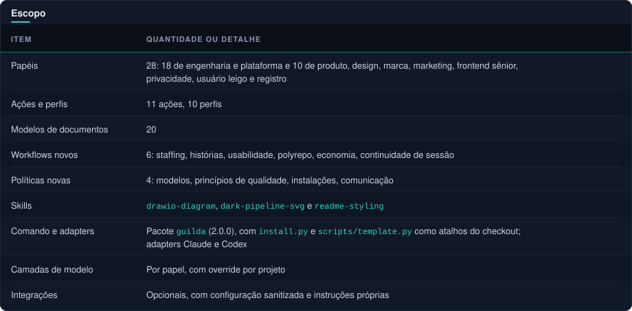

#  Validação da entrega

  
  
  
  
  

[← Voltar ao README](../README.md#sumario) · [Comando guilda](cli.md) · [Compatibilidade](compatibility.md) · [Guia dos diagramas](diagramas.md)

##  Escopo

Ver como texto

| Item | Quantidade ou detalhe |
|---|---|
| Papéis | 28: 18 de engenharia e plataforma e 10 de produto, design, marca, marketing, frontend sênior, privacidade, usuário leigo e registro |
| Ações e perfis | 11 ações, 10 perfis |
| Modelos de documentos | 20 |
| Workflows novos | 6: staffing, histórias, usabilidade, polyrepo, economia, continuidade de sessão |
| Políticas novas | 4: modelos, princípios de qualidade, instalações, comunicação |
| Skills | `drawio-diagram`, `dark-pipeline-svg` e `readme-styling` |
| Comando e adapters | Pacote `guilda` (2.0.0), com `install.py` e `scripts/template.py` como atalhos do checkout; adapters Claude e Codex |
| Camadas de modelo | Por papel, com override por projeto |
| Integrações | Opcionais, com configuração sanitizada e instruções próprias |

A versão 1.2.0 acrescentou economia, continuidade de sessão e comunicação (texto de contrato; ver [Limites](#limites)).

> [!NOTE]
> As skills de diagrama e README e o guia [diagramas.md](diagramas.md) (a partir da 2.0.0) são verificados só por presença e pelo teste de neutralidade. Os scripts das skills não têm testes automatizados.

##  Pacote guilda (2.0.0)

**Verificado:**

- **Versão:** `template.json` e `guilda/__version__.py` em 2.0.0; um teste confere que as duas coincidem.
- **CI do pull request da 2.0.0 (#3), verde:** a suíte na matriz Linux e Windows × Python 3.11, 3.12 e 3.13, a conferência do payload, a busca de material interno versionado e a construção do sdist e do wheel (`python -m build`) seguida de `tests.test_guilda_wheel`. O wheel foi construído e conferido pela CI, não localmente.
- **Publicação:** `guilda` 2.0.0 publicado no PyPI em 2026-11-03, a partir da tag `v2.0.0`.
- **Local (Windows, Python 3.13, 2026-11-03):** a suíte completa (160 testes, 3 ignorados: o de symlink, por privilégio do Windows, e os dois do wheel, porque o módulo `build` não está instalado) e `python -m guilda.payload --check`.
- **Smoke test local da CLI** (`python -m guilda` num diretório temporário, com `GUILDA_CONFIG` apontando para um arquivo descartável com a verificação desligada): `check`; `install --dry-run` e `install` (252 arquivos com os perfis padrão, `check` ok); `upgrade --dry-run` com plano vazio; `check --target`; `doctor`; `self-update --dry-run` e `self-update` sem terminal (cancela com código 1, nada executado); `config get`; `mod token-handoff --dry-run`; o arquivo mantido (o `upgrade` o mantém, `check --target` e `install` acusam `installed drift`, e apagar o arquivo e rodar `upgrade` de novo resolve); `sync` sem `--profiles` numa instalação com três perfis (remove os outros dois perfis); erros de uso com código 2.
- **Testes de unidade com executores simulados:** `upgrade` (classificação por arquivo, arquivo mantido, conflitos com e sem terminal, rollback, plano velho, migração do nome do manifesto e de instalação 1.3.0 com `.engineering/graphify-out/`, esta também pelo instalador real da tag `v1.3.0`), `promote` (varredura de segredos com teste de tempo contra ReDoS, exclusões, confirmação, gist secreto e issue), `self-update` e `config`, e `mod`.

**Não verificado:**

- Instalação a partir do PyPI (`pip install guilda` ou `uv tool install guilda`) num ambiente limpo, nesta revisão.
- `promote` real contra o GitHub (nenhum gist nem issue foi criado), `self-update` real com `pip` e com `uv`, a detecção do `uv` numa instalação real e o modo `auto` (inclusive a troca do executável em uso no Windows).
- `mod` com o `claude` real (`claude plugin marketplace add` e `install`) e o `token-handoff` numa sessão real.
- macOS e versões de Python fora de 3.11 a 3.13.
- O conteúdo do sdist publicado, além da inspeção automática de `scripts/check_dist.py` no fluxo de release.

##  Evidências executadas

- **CLI:** `check`, `doctor`, `init`, `sync` e `package` exercitados em fixtures locais.
- **Suíte Python** (`python -m unittest discover -s tests`): 160 testes, 3 ignorados (o de symlink, por privilégio do Windows, e os dois do wheel, sem o módulo `build`); proteção contra junction validada. Novos testes cobrem camadas de modelo por papel, overrides validados e persistidos no manifesto, papéis de produto e UX (ferramentas e sandbox), usuário leigo somente leitura na camada leve, presença dos workflows, políticas e templates, neutralidade (nenhuma referência a projeto específico) e curadoria de plugins sem instalação.
- **Claude 2.1.294:** validação nativa estrita do plugin e manifesto aprovada após correções.
- **Codex 0.156.1:** `features list` executado; TOML gerado analisado com `tomllib`. A opção `strict-config` não é suportada por esse comando.
- **Onboarding do plugin:** receita documentada executada, contratos disponíveis no consumidor, manifesto não copiado e conflito preservando arquivos.

##  Revisões

Implementação e conteúdo tiveram revisão independente de QA, segurança e arquitetura. Corrigidos: confiança indevida em caminhos do manifesto, instruções que poderiam expor segredos, metadados nativos do plugin, carregamento explícito de contexto e perfis, ferramentas de diagnóstico dos revisores e localização dos contratos no consumidor do plugin.

##  Limites

> [!WARNING]
> **Versão 1.2.0:** as regras de economia, marcos de tokens, retomada e comunicação são contratos em texto, verificados só por presença, renderização e neutralidade (testes). Não foi observado um agente real cumprindo-as, nem o mecanismo automático de [integrations/token-milestones](../integrations/token-milestones/README.md) (apenas especificação, não verificado). A afirmação de que são práticas saudáveis vem do uso em um projeto de origem, não de medição neste template.

**Não executado contra um runtime:**

- Os campos `model` e `model_reasoning_effort` gerados.
- O comportamento de dois usuários leigos reais em paralelo e a rodada de usabilidade completa.
- Chamadas de modelo e descoberta ou invocação real de cada agente ou skill.
- Ativação de MCP e instalação de plugins externos.
- Validação visual do GitHub Projects (board, campos e workflows desligados) e execução real dos scripts de setup contra a API do GitHub.

Os dados de popularidade em [integrations/plugins/curated.json](../integrations/plugins/curated.json) foram lidos das páginas do GitHub em 2026-10-17 e são sinal, não prova de segurança. Disponibilidade detectada no PATH não comprova funcionamento. Aprovação estática e testes locais não representam paridade de runtime entre provedores.
